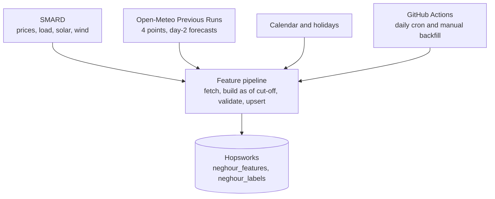

# NegativeHours

> Predict which hours of tomorrow will have a **negative day-ahead electricity
> price** in the DE-LU market, from data known at 10:00 Europe/Berlin, two hours
> before the auction gate closes.

**Author:** Corsin Hidber · HSLU MLOps HS26
**Target:** PR-AUC ≥ 0.75 · F1 ≥ best baseline + 0.10
**Scope:** DE-LU bidding zone · hourly · 2024 to live
**Status:** Milestone 2, feature pipeline. Training and inference are not built yet.

Decisions and changes during MS2 are logged in
[`docs/ms2_decisions.md`](docs/ms2_decisions.md). Changes to the original proposal
are in [`docs/proposal_addendum.md`](docs/proposal_addendum.md).

**Originality:** this is rare-event classification of negative hours for DE-LU;
the decision is yes or no per hour before the auction closes. I looked for the KTH
SE3 price regressors named in the MS1 editorial and could not identify them exactly.
The closest work I found is Vanherpe (2026), a KTH thesis I checked from its
abstract, which studies how weather forecast errors affect intraday prices in SE3.

---

## Task

Binary classification. For each delivery hour:

`y_neg = 1` if the hourly mean DE-LU day-ahead price is below 0 €/MWh.

The market has cleared 15-minute products since 01.10.2025. SMARD's hourly series
stays continuous across that switch: the hourly price before it, the mean of the
four quarter hours after it. The label therefore stays closest to the pre-switch
hourly price across train, validation and test. Separate quarter prices only start
at the switch, so an "any quarter" label would raise the share of negative hours at
that date, and training and test would measure different things. A battery operator
acts per quarter hour, so `n_neg_quarters` is stored as well, which lets that label
be tested later without rebuilding. SMARD rounds to two decimals, so a mean between
−0.005 and 0 reads as 0.00 and counts as not negative.

## Architecture



Live runs and backfills use the same code. The only difference is the date range.

## Time rules

- **Every stored timestamp is UTC.** The key is the UTC hour of delivery, never a
  local date and hour, because German days have 23, 24 or 25 hours.
- **Delivery days and the cut-off are defined in Europe/Berlin.** All times in this
  repo are Berlin time unless marked UTC.
- **"Today" and "tomorrow" come from the Berlin calendar**, not the runner clock.
- **Cut-off:** a row for delivery day D may only use data with
  `available_at <= 10:00 Berlin on D-1`.

Rows are selected by timestamp, never by when a job runs, so a late cron run writes
the same features as an on-time one.

SMARD has no per-row publication time, so `available_at` is rule-based. The rules
are in [`src/neghour/availability.py`](src/neghour/availability.py):

| Data | Counts as available | Basis |
|---|---|---|
| Day-ahead price for day X | 13:00 Berlin on X-1 | Conservative after the 12:00 auction |
| SMARD actual for hour T | End of T + 6 h | Conservative; newest values were 1–3 h old when checked |
| `_previous_day2` forecast, valid T | T − 48 h + 6 h | 48 h is the documented offset; 6 h is an assumed margin |
| Calendar and holidays | 00:00 Berlin on D-1 | Known in advance |

The cut-off is enforced before every write and tested in
[`tests/test_leakage.py`](tests/test_leakage.py). Those tests also remove or corrupt
everything published after the cut-off and require the row to stay identical.

## Features

| Group | Columns | Why |
|---|---|---|
| Price | `price_h_d1`, `price_h_d7`, `neg_hours_last_7d` | Recent price level. Negative hours cluster in high-renewable periods. |
| Weather forecast | `irradiance`, `cloud_cover`, `wind_100m`, `temperature` | Expected solar, wind and heating or cooling demand. |
| Actuals | `load_d2`, `solar_d2`, `wind_d2`, `load_h_d7` | Latest measured system state. D-7 has the same weekday as D. |
| Proxy | `residual_load_proxy` | Expected demand minus expected wind and solar. Low values mean a surplus. |
| Calendar | `hour_of_day`, `weekday`, `month`, `is_weekend`, sine and cosine pairs | Seasonality, below. |
| Holidays | `is_holiday`, `holiday_share` | Demand falls on holidays, many of which are regional. |

Each source also has an `available_at_*` column and a `missing_*` flag.

### Spatial coverage

Prices, production and load cover the whole bidding zone. Weather does not, so it
uses four fixed points, averaged per variable:

| Point | Location | Used for |
|---|---|---|
| `n_coast` | 54.4, 8.7 | Wind: most German capacity is in the windy north |
| `ne` | 53.0, 13.0 | Wind and solar: the north-eastern wind belt and large solar parks |
| `centre` | 51.2, 10.5 | Wind and solar: a mid-country reference |
| `south` | 48.6, 11.0 | Solar: the south has the strongest irradiance and much rooftop solar |

- **Wind** averages `n_coast`, `ne`, `centre`.
- **Irradiance and cloud cover** average `ne`, `centre`, `south`.
- **Temperature** averages all four, because it drives demand everywhere.

### Seasonality

Negative prices follow three cycles, and each is an explicit feature:

- **Within a day:** the solar peak at noon, none at night (`hour_sin`, `hour_cos`).
- **Within a week:** lower demand at weekends (`weekday_sin`, `weekday_cos`,
  `is_weekend`).
- **Within a year:** more solar in spring and summer (`year_sin`, `year_cos`).

Sine and cosine pairs let a model see that hour 23 is next to hour 0.

### Holidays

`holiday_share` is the share of Germany's population with a public holiday that
day, by state. Epiphany, for example, only applies in three states, so a binary flag
would miss it. `is_holiday` is 1 only when all 16 states are off. Luxembourg is about
0.8 % of the zone and is left out.

### Class imbalance

About 6 % of hours are negative. MS3 will use `scale_pos_weight`, not upsampling.
Upsampling would change the class balance the model sees in training but not in
serving, which is training-serving skew.

## Late and missing data

- A source that still fails after three attempts gives NaN plus a `missing_*` flag,
  a warning, and a line in the GitHub step summary.
- Values are never carried forward. A copied forecast or price would be invented
  data that looks real.
- During an outage the daily run writes only the newest delivery day, so good rows
  are not overwritten. The next run repairs that day.
- Hopsworks writes retry on server errors, because upserts are safe to repeat.
- The run fails if validation or storage fails, or if SMARD and Open-Meteo are both
  down. A backfill fails instead of storing gaps.

**Backfill coverage:** rows start at 2024-01-01, but archived forecasts start later.
Solar, cloud and temperature forecasts begin on 2024-01-20 12:00 UTC, and 100 m wind
on 2024-02-17 06:00 UTC. Earlier hours stay as NaN with `missing_weather` set, and
the training-window cut is an MS3 decision.

**Known limitation:** SMARD actuals may be revised after first publication, which
would make backfilled rows slightly cleaner than live ones. This has not been measured.

## Data sources and licences

| Source | Used for | Key | Licence |
|---|---|---|---|
| [SMARD](https://www.smard.de) (Bundesnetzagentur) | Prices (filter 4169), load, solar, wind | None | CC BY 4.0 |
| [Open-Meteo](https://open-meteo.com) Previous Runs API | `_previous_day2` forecasts, default model | None | CC BY 4.0; free tier is non-commercial |
| [Statistikportal](https://www.statistikportal.de/de/bevoelkerung/flaeche-und-bevoelkerung) | Population by state, 2025, based on census 2022 | n/a | See source |

## Setup

Requires Python 3.11 and [uv](https://docs.astral.sh/uv/). A
[Hopsworks](https://www.hopsworks.ai) project is needed to store data.

```bash
uv sync --frozen --extra dev
cp .env.example .env   # add HOPSWORKS_API_KEY to .env; never commit that file
```

## Run

```bash
# Daily run: Berlin today - 7 days through Berlin tomorrow
uv run --frozen python -m neghour.pipelines.feature_pipeline

# Backfill: defaults to 2024-01-01 through tomorrow
uv run --frozen python -m neghour.pipelines.backfill
uv run --frozen python -m neghour.pipelines.backfill --first-day 2025-01-01 --last-day 2025-01-31

# Dry run against live sources, storing nothing
STORAGE_BACKEND=memory uv run --frozen python -m neghour.pipelines.feature_pipeline

# Report on what is stored
uv run --frozen python scripts/check_store_quality.py
```

Both pipelines are idempotent: rows are upserted by UTC delivery hour, so a rerun
adds nothing.

### Docker

```bash
docker build -t neghour .
docker run --rm --env-file .env neghour
```

Keys are passed at run time and are never part of the image.

### Tests

```bash
uv run --frozen pytest -v
uv run --frozen ruff check src tests scripts
```

Source tests use recorded API responses in `tests/fixtures`, never live calls.
Refresh them with `uv run --frozen python scripts/record_fixtures.py`.

## Orchestration

| Workflow | Trigger | Steps |
|---|---|---|
| `daily_pipeline.yml` | Cron 01:17, 05:17 and 12:17 UTC, or manual | Feature pipeline |
| `backfill.yml` | Manual | Backfill, then a report on stored data |
| `ci.yml` | Push to main, PR, or manual | Lock check, ruff, pytest, Docker build |
| `check_hopsworks.yml` | Manual | Hopsworks round-trip check |
| `docker_run.yml` | Manual | Builds the image and runs the pipeline inside it |
| `weekly_training.yml` | Manual | Not implemented until MS3 |

GitHub cron is in UTC and has started this repo's jobs 4 to 9 hours late, so the
daily run has two morning slots: 02:17 and 06:17 CET, or 03:17 and 07:17 CEST.
Because rows are selected by timestamp, late runs stay correct, and the second
run repairs anything the first one missed.

A third slot at 12:17 UTC (13:17 CET, 14:17 CEST) refreshes labels. The auction
closes at 12:00, so the morning runs cannot see the next day's prices. This run
stores those labels the same day, not the next morning, and it gives one more
scheduled chance each day. It starts after the cut-off on purpose: features are
still selected by `available_at`, so it adds no later data to them.

**Secret:** `HOPSWORKS_API_KEY` in GitHub Secrets. Locally it goes in `.env`, which
is gitignored.

**Variable:** `HOPSWORKS_HOST` in GitHub Variables, the Hopsworks instance host. It
is not a secret and is not hardcoded, so the code runs against any instance.

**Hopsworks cost:** the feature groups are offline only, with `stream=False`, Delta
and statistics off, so the client writes the tables directly and inserts start no
Spark job. Reads go through the Feature Query Service. Creating the groups also
created two `compute_stats` job definitions; neither has run.

## Monitoring plan (MS3)

Not built yet, because it needs a model and stored predictions. The plan:

- **Rolling scores:** PR-AUC and F1 over the last 30 delivery days, joining
  predictions to labels on the UTC hour, for the model and for both baselines
  (same hour on D-1 and on D-7). Negative hours are rare and seasonal, so a
  window with few of them is reported as such, not as a score.
- **Drift check:** each week, compare `residual_load_proxy`, `wind_100m` and
  `irradiance` with the training window using the population stability index,
  and warn above 0.2.

## Repository

```text
src/neghour/
├── availability.py   publication rules, in one place
├── timeutils.py      Berlin days, cut-off, DST-safe lags
├── config.py         settings, grid points, populations
├── sources/          SMARD, Open-Meteo
├── features/         build, calendar, validation
├── storage/          interface, Hopsworks, in-memory
└── pipelines/        feature pipeline, backfill
```
