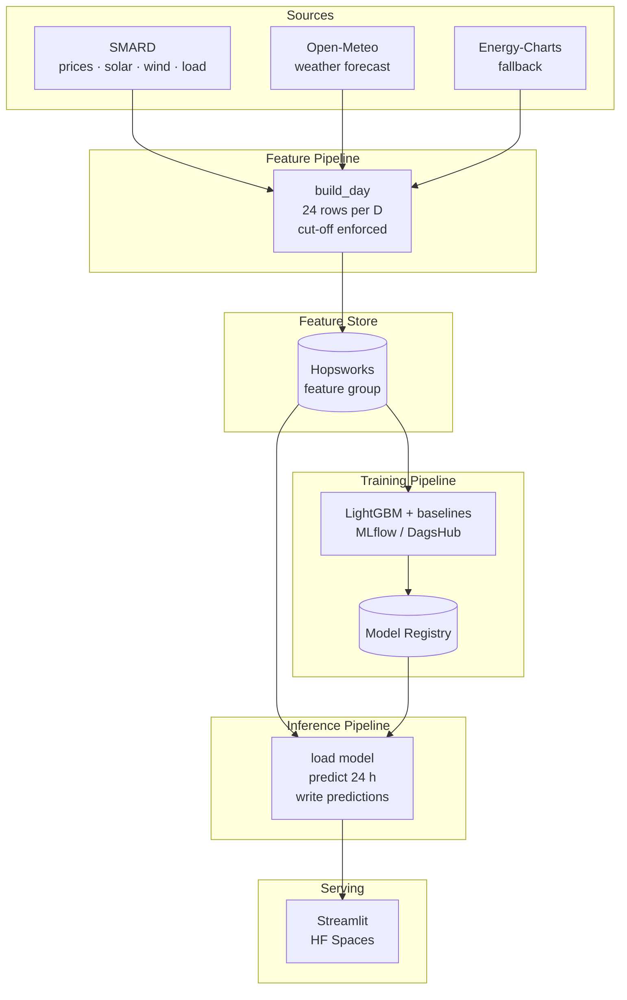

# NegativeHours

> Predict which hours of tomorrow will have a **negative day-ahead electricity price**
> in the DE-LU market — issued every morning at 10:00 Berlin time, two hours before
> the auction gate closes.

**Author:** Corsin Hidber · HSLU MLOps HS26
**Target:** PR-AUC ≥ 0.75 · F1 ≥ best baseline + 0.10
**Scope:** DE-LU bidding zone · hourly · 2024 → live

---

## Architecture (FTI pipelines)



---

## Data sources

| Source | Used for | API key |
|--------|----------|---------|
| [SMARD](https://www.smard.de) (Bundesnetzagentur) | Prices (filter 4169), solar, wind, load | None |
| [Open-Meteo](https://open-meteo.com) (Previous Runs API) | Weather forecast as issued on D-2 | None |
| [Energy-Charts](https://api.energy-charts.info) (fallback) | Prices & generation if SMARD is down | None |

---

## Setup

### Prerequisites

- Python 3.11+
- [uv](https://docs.astral.sh/uv/) — `pip install uv`
- Free accounts: [Hopsworks](https://app.hopsworks.ai), [DagsHub](https://dagshub.com)

### Install

```bash
uv sync
cp .env.example .env   # fill in HOPSWORKS_API_KEY and DAGSHUB_TOKEN
```

### Run pipelines locally

```bash
# Build features for tomorrow (D)
uv run python -m neghour.pipelines.feature_pipeline

# Run inference after features are ready
uv run python -m neghour.pipelines.inference_pipeline

# Full retrain (runs weekly in CI)
uv run python -m neghour.pipelines.training_pipeline
```

### Tests

```bash
uv run pytest tests/ -v
```

### Streamlit dashboard

```bash
uv run streamlit run app/app.py
```

---

## Orchestration

| Workflow | Schedule | Steps |
|----------|----------|-------|
| `daily_pipeline.yml` | 10:00 Berlin (08:00 UTC) daily | feature pipeline → inference pipeline |
| `weekly_training.yml` | Sunday 02:00 UTC | retrain + register if criteria met |
| `ci.yml` | every push / PR | lint (ruff) + pytest |
